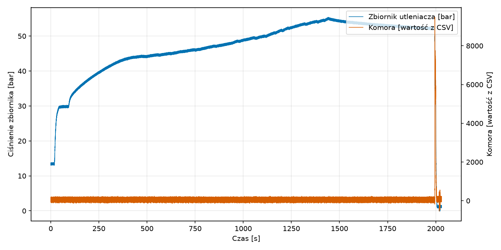
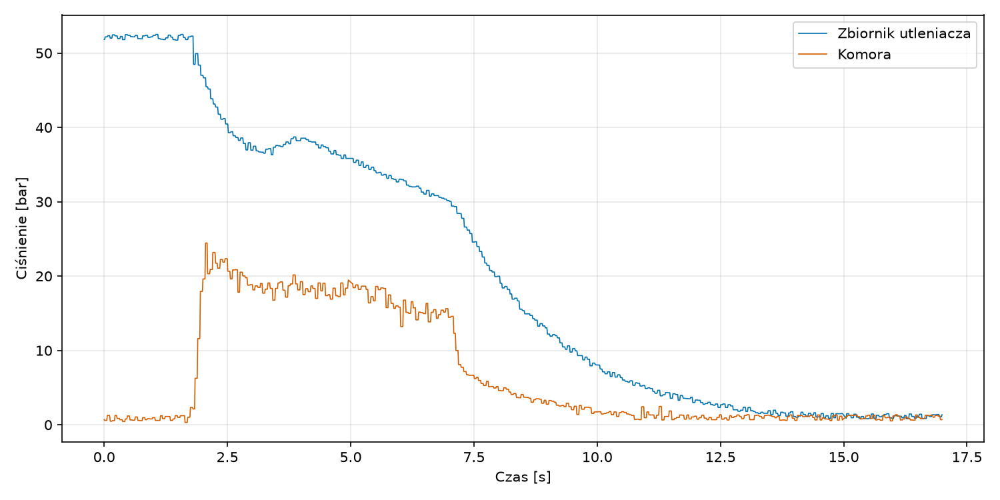
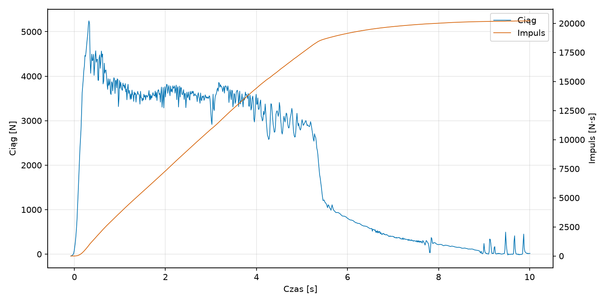

# Static 15.10.2026

## Konfiguracja i Wyniki
<!-- | Konfiguracja Systemu | Parametry Operacyjne | Wyniki Silnikowe |
| :--- | :--- | :--- |
| <-- **Software:** [v0.3.0](https://github.com/Simba-Avionic/srp/releases/tag/v0.3.0) --> | **Utleniacz:** 9.7 kg \\( N_2O \\) ± 200g | **\\( I_{tot} \\):** 20222.9512 Ns |
| **Hardware:** [Engine Computer](../../../common/EngineComputer_schematic.pdf) | **Ciśnienie:** 52Bar | **Max Thrust:** 4750.7N |
<!-- | **Próbkowanie Tensobelki:** 320Hz | **Temp. Otoczenia:** 10°C | **Burn Time:** 10s | -->
| **Próbkowanie Ciśnienia zbiornika:** 10Hz | **masa (wypalonego) paliwa:** 2.323 kg  | |
<!-- | **Próbkowanie Ciśnienia komory:** 166Hz | **Paliwo:** 84% parafina, 15% hotglue, 1% sadza | | -->

## Wykresy 

### Wykres cisnienia Zbiornika i Komory

#### Cały  test

Archiwalny obraz PNG

#### Start

Archiwalny obraz PNG

### Wykres ciągu

Archiwalny obraz PNG

## Post-Mortem

### Reszta wniosków
- Nawet składając te samą rakietę 4 raz bez checklisty zdarzają się błędy
- Projekt TestBox jest super inicjatywą

## Materiały

|  |
|:---:|
| [Zdjęcia & Nagrania](https://drive.google.com/drive/folders/1318bVYpF_e5ZVnfPuNZcweQkrWOe7sXs)
| [Dane GS]( https://drive.google.com/drive/folders/1lCE797Zv3mZs0NX4CaekcU8_AeBpV8zL)

